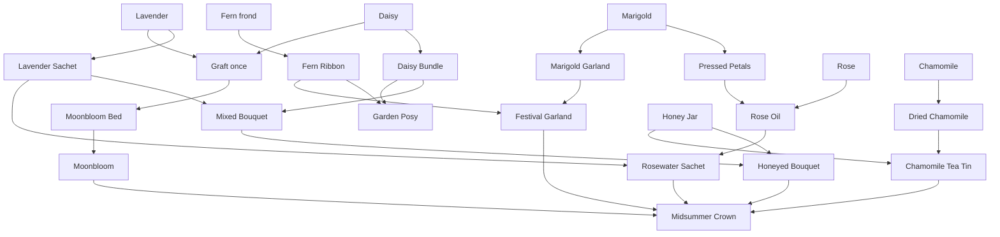

# Petalworks — Progression Roadmap

A design proposal for the full game after the first-pass slice. The slice (about 15–30 minutes, six hand-authored orders) stays exactly as [BRIEF.md](../BRIEF.md) specifies. This document is the 2–3 hour arc that comes after order 6, plus the seams that arc needs in the slice's architecture.

Nothing here is first-pass scope. [SLICE_ARCHITECTURE_RISKS.md](SLICE_ARCHITECTURE_RISKS.md) lists the five slice decisions that are expensive to change once the longer arc exists.

Player-facing language in this proposal uses American English, matching the producer notes.

## What the longer game feels like

The slice teaches a tiny workshop: grow a flower, move it, transform it, ship it. The rest of the game opens the meadow around that workshop one idea at a time. Each chapter adds a single puzzle. Previous machines keep working. The player is never asked to throw a layout away, sit through a timer, or repeat an order for currency.

The ending is **the Midsummer Showing**. Neighbors have left a standing invitation, written on the first order slips in Wren's handwriting. Wren stays flavor text. There is still no controllable character. When the player ships one Midsummer Crown, the garden keeps running, a guestbook fills in, and a few optional neighbor notes appear. There is no prestige reset, no score attack, and no second currency.

### Rules that apply to every chapter

- **Orders ask for items, and they wait.** No deadlines, no expiring requests, no fail state. A weather line in the copy is a hint, never a clock.
- **Counts stay small.** Time is spent arranging the garden. Once a chain runs, delivery is a short pleasure, not a wait for the fiftieth daisy. If a chapter playtests short, add a tighter plot of land, not a larger order.
- **New tools that route or buff are optional in the best sense.** A Ribbon Gate, a hive's square, and a sheltered tile make a layout calmer. The order can still be finished without them. A machine that is the only source of a product (the press, the hoop, the apiary, the graft, the showing table) is required, the same way the slice's Arrangement Table is required for a bouquet.
- **Nothing is consumed as upkeep.** Belts do not need fuel. The Sunjar does not burn out. The apiary does not eat flowers. Removing a structure refunds its full cost, and any items inside go to the basket described in the asset specs.
- **The simulation stays deterministic.** Growth modifiers are flat multipliers. Weather is a fixed cycle. Grafts are a curated list. The sim does not roll dice.
- **No monetization.** No ads, accounts, energy, premium currency, or paid unlocks. Coins come from orders and exist to buy the next bed, machine, or plot.
- **One new idea per chapter.** New flowers and recipes can share a chapter with that idea. A second new system cannot.

## The recipe tree

Times are starting balance knobs, in seconds, same as the brief. Store them as integer ticks (see the risks doc). Slice rows are marked so the trunk stays visible.

### Flowers

| Flower | Bed | Time | Opens | Role |
| --- | --- | --- | --- | --- |
| Daisy | Daisy Bed | 4s | Slice | Starter flower. Bundles, and one half of the graft. |
| Lavender | Lavender Bed | 6s | Slice | Starter herb. Sachets, and the other half of the graft. |
| Marigold | Marigold Bed | 5s | Ch. 1 | Splits into petals and garlands. Both paths reach the crown. |
| Fern frond | Fern Bed | 5s | Ch. 3 | Greenery. Becomes a ribbon, then half of the festival garland. |
| Chamomile | Chamomile Bed | 7s | Ch. 6 | Tea herb. Shares the Drying Bench with lavender. |
| Rose | Rose Bed | 9s | Ch. 7 | Slow and precious. Becomes oil only while a Sunjar is near. |
| Moonbloom | Moonbloom Bed | 10s | Ch. 8 | The grafted flower. The bed is a permanent unlock after one graft. |

Beds keep the slice's behavior: one item at a time, pause when the output tile is blocked, and show growing, ready, and blocked.

### Machines and products

| Product | Machine | Inputs | Time | Opens |
| --- | --- | --- | --- | --- |
| Daisy Bundle | Bundling Table | 2 Daisy | 5s | Slice |
| Lavender Sachet | Drying Bench | 2 Lavender | 7s | Slice |
| Mixed Bouquet | Arrangement Table | 1 Daisy Bundle + 1 Lavender Sachet | 8s | Slice |
| Pressed Petals | Flower Press | 2 Marigold | 8s | Ch. 1 |
| Marigold Garland | Garland Hoop | 3 Marigold | 6s | Ch. 3 |
| Fern Ribbon | Garland Hoop | 2 Fern frond | 4s | Ch. 3 |
| Garden Posy | Arrangement Table | 1 Daisy Bundle + 1 Fern Ribbon | 8s | Ch. 3 |
| Festival Garland | Arrangement Table | 1 Marigold Garland + 1 Fern Ribbon | 8s | Ch. 3 |
| Honey Jar | Apiary | none (see aura below) | 12s | Ch. 4 |
| Honeyed Bouquet | Arrangement Table | 1 Mixed Bouquet + 1 Honey Jar | 10s | Ch. 4 |
| Dried Chamomile | Drying Bench | 2 Chamomile | 7s | Ch. 6 |
| Chamomile Tea Tin | Tea Caddy | 1 Dried Chamomile + 1 Honey Jar | 8s | Ch. 6 |
| Rose Oil | Flower Press | 1 Rose + 1 Pressed Petals | 10s | Ch. 7 |
| Rosewater Sachet | Arrangement Table | 1 Lavender Sachet + 1 Rose Oil | 9s | Ch. 7 |
| Moonbloom cutting | Grafting Bench | 1 Daisy + 1 Lavender | 15s | Ch. 8, once |
| Midsummer Crown | Showing Table | 1 Honeyed Bouquet + 1 Festival Garland + 1 Rosewater Sachet + 1 Chamomile Tea Tin + 1 Moonbloom | 20s | Ch. 9 |

The Grafting Bench's lasting product is the Moonbloom Bed unlock. It also places one Moonbloom in the output, so the first graft is a keepsake you can ship or hold. Later Moonblooms come from the bed.

Garden Posy is a practice arrangement. It teaches the Arrangement Table's new recipe before the Festival Garland and it stays in the guestbook. It is not a crown ingredient.

Every grower still reaches the crown:

- Daisy and lavender meet in the Mixed Bouquet, and again at the graft.
- Marigold splits. Petals plus a rose become Rose Oil, then Rosewater. Garlands plus fern ribbons become the Festival Garland.
- Fern joins the crown through that garland.
- Chamomile and honey meet in the tea tin. Honey also crowns the original bouquet.
- The Moonbloom is carried in whole.



### Structures that move or light, and do not craft

| Structure | Kind | What it does | Opens |
| --- | --- | --- | --- |
| Conveyor Belt | transport | Slice behavior, unchanged. | Slice |
| Ribbon Gate | transport | Zero processing time. Matching items leave by the side port; everything else leaves forward. A blocked chosen port holds the item. Items are never deleted or allowed to leak down the wrong path. | Ch. 2 |
| Apiary | processor + aura | Makes a Honey Jar every 12s. Pollination aura, Chebyshev radius 3: beds inside grow in 0.8× the time, floored at 2s. Extra hives do not stack. The aura stays while honey is backed up. | Ch. 4 |
| Sunjar | aura | Warmth, Chebyshev radius 2, no item ports, no fuel. Rose Oil sleeps until a Sunjar covers the press. Several jars do not stack. | Ch. 7 |
| Packing Station | sink | Slice behavior. The crown ships here too. | Slice |

The Ribbon Gate is rotated with the same control as belts. Facing is the forward path. The side path is the left of facing. The player picks the diverted item from the items they have unlocked, in the inspector. The slice's "wrong item" badge covers an item waiting because its port is full.

## Chapters

An unlock adds a recipe, a machine, or a plot to what the player may buy. It does not place the building for free. The order that offers it pays for that purchase, with coins left over for a few extra belts. Exact coin numbers live in `src/sim/data/` and scale to whatever the slice already uses. New beds cost about what a Daisy Bed costs. New processors cost about what a Bundling Table costs. The gate, the Sunjar, and belts stay cheap. Plot prices sit inside the surplus of the chapter that offers them. Removing anything returns its full price.

Pacing targets for a first playthrough that lingers on the layout: the slice 15–30 minutes, Chapters 1, 2, and 4–8 about 15 minutes each, Chapters 3 and 9 about 20 minutes. Together that is a little under three hours. Counts are small, so a fluent player finishes sooner. If a chapter playtests short, tighten the new plot instead of raising the counts.

### Chapter 0 — The slice

The six orders in the brief. Daisy shipping, bundling, throughput, lavender, sachets, one Mixed Bouquet. The playable plot grows from 16×12 to 20×14. After order 6 the slice's sandbox moment stays, and the Marigold Bed enters the palette. That is the doorway into Chapter 1.

**Puzzle:** production, belts, a second chain, two inputs.

**Systems:** the whole slice architecture, built with the seams in the risks doc.

### Chapter 1 — Marigolds and the press

**Introduces:** Marigold Bed (already in the palette), Flower Press, Pressed Petals.

**Puzzle:** one flower, two honest destinations. An order wants petals and also a daisy product, so the press and the bundling table each need a path. The player splits the stream by laying two belts. The split uses belt geometry the slice already taught. The Ribbon Gate arrives only at the end of the chapter, as the tool for what comes next.

**Orders:**

| Order | Asks for | Unlocks on delivery |
| --- | --- | --- |
| 1 | 3 Marigold | Flower Press |
| 2 | 2 Pressed Petals | — |
| 3 | 2 Pressed Petals + 2 Daisy Bundles | Ribbon Gate, East Herb Walk |

Multi-line orders begin here. The HUD already shows "requirements and progress" in the slice; each requirement is a line with its own count.

**Systems:**

- `data/`: a new bed, a new machine, recipes whose input list can be a count of one item, orders with a `lines[]` array.
- `production.ts`: press uses the same buffer, timer, and blocked-output path as the Bundling Table.
- `orders.ts`: progress is a map of item id to delivered count. A one-line slice order is a map with one key.
- `grid.ts`: the east walk, offered by order 3, reveals locked cells already addressed in the meadow. The potting corner keeps its coordinates.

### Chapter 2 — The Ribbon Gate

**Introduces:** the Ribbon Gate, on the East Herb Walk offered at the end of Chapter 1.

**Puzzle:** a shared trunk. Daisies and marigolds can ride one belt. The gate peels marigolds toward the press and lets daisies continue. This is the quietly clever logistics moment of the game. The 20×14 corner can still finish the orders with two separate belts; the walk is where the shared trunk has room to breathe.

The hold rule is the puzzle's teeth: if the marigold port is full, marigolds wait on the gate, and daisies behind them wait too. A matching item stays on the gate until its own port can take it, which is the same backpressure the slice's blocked beds already taught. The east walk is sized so that shared trunk fits.

**Orders:**

| Order | Asks for | Unlocks on delivery |
| --- | --- | --- |
| 1 | 3 Daisy Bundles + 2 Pressed Petals | — |
| 2 | 2 Pressed Petals + 2 Lavender Sachets | Garland Hoop |

**Systems:**

- `types.ts`: a structure `kind` of `transport`, and ports that are not "accept anywhere, emit on facing."
- `transport.ts`: the gate resolves in the same tick as belts, with the same contested-destination rule. It has no processing timer.
- `data/`: the filter is `{ divertItemId }` on the placed structure, saved.
- `ui/`: the inspector lists unlocked item ids. The selected gate shows both exit arrows.
- `game/` (Phaser): a side-exit sprite variant. Art stays behind the manifest, same as belts.

### Chapter 3 — Ferns and the hoop

**New:** Fern Bed, Garland Hoop, Fern Ribbon, Marigold Garland, Garden Posy, Festival Garland.

**Puzzle:** batch size, and a machine that must not drink the wrong flower. The hoop is pinned to one recipe at a time. While it is making garlands it accepts only marigolds, three at a time. Ferns arriving on that belt stop with the wrong-item badge until the player changes the pin or moves the belt. The batch of three fills slower than the slice's batch of two, so a short belt in front of the hoop is the comfortable shape. That is the whole lesson.

**Orders:**

| Order | Asks for | Unlocks on delivery |
| --- | --- | --- |
| 1 | 2 Marigold Garlands | Fern Bed |
| 2 | 2 Fern Ribbons | Garden Posy recipe |
| 3 | 1 Garden Posy | Festival Garland recipe |
| 4 | 1 Festival Garland | Apiary, Lower Terrace |

**Systems:**

- `data/`: many recipes can name the same machine. Input counts of 2 and 3 live on the recipe, not in code.
- `types.ts`: a placed machine stores `selectedRecipeId`. Slice machines with one recipe store that id too.
- `production.ts`: typed input slots for the selected recipe. A slot holds only its item id, up to a small cap (5 is enough). This is also what keeps the slice's Arrangement Table from filling with bundles and never accepting a sachet.
- `ui/`: a recipe picker in the inspector, and slot counts.

### Chapter 4 — The apiary

**New:** Apiary, Honey Jar, Honeyed Bouquet. The Lower Terrace opens.

**Puzzle:** a square of influence. The hive covers a 7×7 neighborhood (Chebyshev radius 3). Beds inside grow a little faster. Beds outside keep their ordinary timing. A second hive on a bed already inside a square adds nothing, so the terrace is a placement puzzle: one hive, and a choice of which beds sit with it.

Honey is an output with no item input. It keeps appearing when the output tile is free. If honey backs up, the flowers stay quick. The aura is a kindness, not a second production chain to feed.

**Orders:**

| Order | Asks for | Unlocks on delivery |
| --- | --- | --- |
| 1 | 1 Honey Jar | Honeyed Bouquet recipe |
| 2 | 1 Honeyed Bouquet | Forecast slate and Glasshouse plot (Chapter 5 begins) |

**Systems:**

- `grid.ts`: `tilesInRadius(x, y, radius)` using Chebyshev distance, plus a way to list beds whose anchor sits in that set.
- `types.ts`: an `aura` block on a machine definition, separate from ports. `{ kind: "pollination", radius: 3, growthMul: 0.8, minSeconds: 2 }`.
- `production.ts`: when a bed starts a growth cycle, it reads the strongest pollination multiplier covering it. Placement changes recompute the next cycle. No per-frame buff.
- `game/`: selecting the hive draws the square. Reduced-motion shows the square as a still outline.
- `save.ts`: the hive is an ordinary structure. The aura is derived, not saved.

### Chapter 5 — Weather and the glasshouse

**New:** a forecast, and the Glasshouse plot. No new product.

**Puzzle:** a few sheltered tiles, and a forecast you can read. The cycle is Sun, Cloud, Soft Rain, Cloud, and repeat. Each phase lasts 90 seconds of sim time. The slate shows the current phase and the next two. The cycle is a fixed index on the world tick, so reloading cannot reroll it.

| Phase | Beds | Drying Bench | Apiary |
| --- | --- | --- | --- |
| Sun | 1.0× | 1.25× | 1.15× |
| Cloud | 1.0× | 1.0× | 1.0× |
| Soft Rain | 1.25× | 0.5× | 0.85× |

Glasshouse tiles are always Cloud, whatever the sky is doing. The house is 12×8, so the player chooses which machines get the calm. Drying inside is steady. Beds left out in the rain grow a little faster, which is the reason to leave them outside. Nothing stops, nothing spoils, nothing is destroyed. A player who never looks at the slate simply has slightly uneven timing.

**Orders:**

| Order | Asks for | Unlocks on delivery |
| --- | --- | --- |
| 1 | 4 Lavender Sachets | — |
| 2 | 2 Garden Posies | Chamomile Bed |

The sachet order is the same product the slice already taught. The new information is the slate. Copy can mention the rain. The order does not expire when the rain arrives.

**Systems:**

- `types.ts`: `world.weather = { phaseIndex, tickInPhase }` and a terrain id on each plot.
- `data/`: phase table and per-recipe or per-machine multipliers. Terrain ids: `lawn`, `glasshouse`, `showing`, `locked`.
- `game.ts`: advance the weather clock inside the sim tick. Emit a phase-changed event for the renderer.
- `production.ts`: effective duration is `baseTicks × weatherMul × auraMul`, computed when a cycle starts, and recomputed if a phase changes mid-cycle by scaling the remaining ticks. Sheltered terrain substitutes the Cloud row.
- `grid.ts`: placement reads `allowedTerrain` on the definition. Slice buildings allow `lawn` and `glasshouse`.
- `ui/`: a small forecast slate in the top bar, using the same order-slip language. No modal when the weather turns.
- `save.ts`: persist the weather index. Old saves without it start at Sun, tick 0.

### Chapter 6 — Tea

**New:** Chamomile Bed, Dried Chamomile, Tea Caddy, Chamomile Tea Tin.

**Puzzle:** two earlier ideas on one recipe. Tea needs honey, which is passive, and dried chamomile, which is the weather-sensitive bench. The Drying Bench now has two recipes, so the pin from Chapter 3 matters again: lavender sachets and chamomile share a machine, and the player either pins one and runs it, or places a second bench. A second bench is affordable on purpose.

The Tea Caddy is a single-recipe machine so the Arrangement Table does not become a menu. If art budget prefers fewer machines, the tea recipe can move onto the Arrangement Table by changing data only, as long as recipes name their machine by id.

**Orders:**

| Order | Asks for | Unlocks on delivery |
| --- | --- | --- |
| 1 | 2 Dried Chamomile | Tea Caddy |
| 2 | 1 Chamomile Tea Tin | — |
| 3 | 1 Chamomile Tea Tin + 1 Honeyed Bouquet | Rose Bed |

**Systems:**

- Same multi-recipe path as the hoop. No new simulation system.
- `orders.ts`: a line can ask for an item the player already knows how to make. Keep the slice chain relevant by asking, not by removing old machines.

### Chapter 7 — Roses and the Sunjar

**New:** Rose Bed, Sunjar, Rose Oil, Rosewater Sachet.

**Puzzle:** a lamp beside the press. Rose Oil is a second recipe on the Flower Press: one rose plus one Pressed Petals, and a Sunjar within radius 2. Until warmth covers the press, the recipe waits and the press shows a sleeping badge. Petals and roses already in their typed slots stay put. The Sunjar has no item ports and shines for as long as it stands. Pressed petals, the teaching item from Chapter 1, come back as the partner ingredient.

One Sunjar covers a 5×5 square, enough for the press and a neighbor. Warmth is that square. It has no wires and no fuel.

**Orders:**

| Order | Asks for | Unlocks on delivery |
| --- | --- | --- |
| 1 | 2 Roses | Sunjar, Rose Oil recipe |
| 2 | 1 Rose Oil | Rosewater recipe |
| 3 | 1 Rosewater Sachet | Grafting Bench |

**Systems:**

- `types.ts`: aura kind `warmth`. A recipe may list `requires: [{ aura: "warmth" }]`.
- `production.ts`: before a cycle advances, check the aura. Missing warmth emits the existing blocked/waiting style event with a distinct reason code, `asleep`, so the UI can use a new badge without a new state machine.
- `data/`: Rose Oil's extra requirement is data. Pressed Petals stay a recipe with no requirement.
- `ui/`: the inspector says what the press is waiting on, in words, alongside the slot counts.

### Chapter 8 — The graft

**New:** Grafting Bench, then Moonbloom Bed.

**Puzzle:** bring the two starter flowers to one bench, once. The bench accepts one daisy and one lavender, works for 15 seconds, and on completion adds `moonbloom-bed` to the unlock set and outputs one Moonbloom. That recipe then rests. The Moonbloom Bed grows every Moonbloom after the keepsake. The bench can be refunded; the unlock remains.

The pair is fixed. The flower has no stats. A second curated pair can sit in data for the sandbox (Marigold + Rose, named in the guestbook if crafted) and the crown does not ask for it. The daisy-and-lavender graft is the whole critical path, and it runs once per garden.

**Orders:**

| Order | Asks for | Unlocks on delivery |
| --- | --- | --- |
| 1 | 1 Moonbloom | — |
| 2 | 1 Moonbloom + 1 Mixed Bouquet | Showing plot, Showing Table |

**Systems:**

- `data/`: a recipe effect `{ type: "unlock", id: "moonbloom-bed" }` that fires once. Unlock ids are strings in a set.
- `production.ts`: on craft, apply effects, then output the item as usual.
- `save.ts`: the unlock set is the source of truth. Re-crafting does not duplicate it.
- `orders.ts`: the order asks for a Moonbloom. Order 1 can be the keepsake from the bench. Order 2 needs another, which the bed grows.

### Chapter 9 — The Showing

**New:** the Showing plot and the Showing Table. The crown recipe.

**Puzzle:** five ingredients, in any order, with no clog. The table has one typed slot per ingredient, each able to hold a few. Early ingredients wait in their slots while the player finishes a slower chain. Belts can deliver and leave. When all five slots hold at least one, the table crafts for 20 seconds and outputs one crown onto its facing tile. The player routes that crown to the Packing Station. Shipping it completes the game. The table then displays a crown on the showing lawn (a visual flag set when the order completes).

Partial progress uses the same lines component as a multi-line order, so the late game does not invent a new reading skill.

**Orders:**

| Order | Asks for | On delivery |
| --- | --- | --- |
| The Showing | 1 Midsummer Crown | Guestbook opens. Encore notes appear. No further unlock is required to keep playing. |

**Systems:**

- `production.ts`: N typed slots, already required by Chapter 3. The crown is the case that proves the cap is per item id.
- `grid.ts`: Showing terrain accepts the Showing Table, paths, and decor. Beds and processors stay on lawn and glasshouse, via `allowedTerrain`.
- `orders.ts`: completing this order id sets a `guestbookUnlocked` flag. The reward is coins plus that flag, not a new currency.
- `ui/`: the ending is a panel the player can close, with the garden still running underneath. Reopen it from the guestbook. No modal during ordinary play, and this panel is the one ceremony.
- `game/`: a short petal shower using the existing petal effects. Reduced-motion keeps the chime and skips the shower.

## How orders evolve

| Stage | What the player sees | What changed |
| --- | --- | --- |
| Slice | One order. One item line. A fixed sequence of six. | Teaching. |
| Chapters 1–3 | One pinned order. Some orders have two lines. The sequence is still fixed. | `lines[]`. The other line waits in the packing counts the slice already stores. |
| Chapters 4–7 | A chapter board with up to two slips visible. The player pins one. The other waits, with no expiry. Finishing the chapter's set opens the next chapter. | `orders.ts` holds offered ids, one active id, and per-order progress. |
| Chapters 5–6 | Slip copy can mention the sky. | Flavor string only. No timestamp on the order. |
| Chapters 7–9 | Slips ask for something new and something the garden already makes. | Content, not a new rule. |
| After the crown | The board clears. Eight encore notes appear, hand-authored, repeatable, flat modest pay. They buy nothing required. | A `repeatable` flag on the order record. Completing one does not remove it. |

Encore notes exist so the sandbox has a reason to watch the garden run. They are not a generator, and they are not the spine of progression. A procedural generator is out of this roadmap. If one is ever added, it belongs in sandbox data, it only requests unlocked items, and it uses the sim's seeded random stream rather than `Math.random`.

Chapter unlocks that are machines or recipes appear in the build palette only once unlocked, which is the slice rule. The forecast slate appears with Chapter 5, because a control for a system that does not exist yet would violate "no fake features."

## The meadow

The address space is a **32 × 22** grid. The origin is the northwest corner and never moves. `x` grows east, `y` grows south. Expansions reveal locked cells in place. They never renumber a placed machine.

The slice's 16×12 potting corner is the northwest of this meadow. The slice's 20×14 expansion is the south rim of that corner. Later plots are already in the coordinate space, drawn as locked grass until bought.

```
x →     0          16    20                32
y 0     ┌────────────────┬─────────────────┐
        │ potting 16×12  │ east herb walk  │
        │ south rim makes│ 12×14 lawn      │
y 14    │ this 20×14     │ ch. 2           │
        ├──────────┬─────┼─────────────────┤
        │ showing  │ terrace │ glasshouse  │
        │ 10×8     │ 10×8    │ 12×8        │
        │ ch. 9    │ ch. 4   │ ch. 5       │
y 22    └──────────┴─────────┴─────────────┘
```

| Plot id | Cells | Terrain once open | Opens |
| --- | --- | --- | --- |
| `potting` | (0,0)–(15,11) | lawn | New game |
| `south-rim` | the rest of (0,0)–(19,13) | lawn | Slice milestone |
| `east-walk` | (20,0)–(31,13) | lawn | Start of Chapter 2 (offered with the Ribbon Gate) |
| `terrace` | (10,14)–(19,21) | lawn | Start of Chapter 4 (offered with the Apiary) |
| `glasshouse` | (20,14)–(31,21) | glasshouse | Start of Chapter 5 |
| `showing` | (0,14)–(9,21) | showing | Start of Chapter 9 |

Locked cells use the `ground.locked` art already specified. Glasshouse ground is a new manifest key in the same family (pale cream mullions, warm wood, same top-left light). The showing lawn is a quieter lawn with a low rope border, also a manifest key. Decorative hedges from the asset spec can sit on the borders without occupying buildable logic, because decor is already a separate layer.

Camera bounds come from the unlocked rectangles plus a small margin, not from a constant of 20×14.

The terrace is 10×8 so one radius-3 hive is a composition, not a stamp. The glasshouse is large enough for a drying bench, a press, a Sunjar, and the belts between them, and small enough that the whole factory cannot hide inside it.

## The late-game goal

The Midsummer Showing is one craft and one shipment.

The player already knows every verb it uses: pin a recipe, fill typed slots, wait, put the result on a belt, pack it. The new feeling is that the whole meadow contributes one item each. The crown's five ingredients are the five branches:

| Branch | Crown ingredient | Chapters it remembers |
| --- | --- | --- |
| The original bouquet, crowned with honey | Honeyed Bouquet | Slice, apiary |
| Marigolds and ferns | Festival Garland | Press, hoop, gate |
| Roses, petals, and a sachet | Rosewater Sachet | Press, Sunjar |
| Chamomile and honey | Chamomile Tea Tin | Weather, drying, apiary |
| The grafted flower | Moonbloom | Graft |

After the crown ships:

- The guestbook lists every order, with the date replaced by the in-game chapter name. No real-world clock.
- The showing lawn keeps a crown sprite. Removing the Showing Table does not remove the memory; the guestbook flag stays.
- Encore notes pay a flat, small amount. They cannot gate a refund, a plot, or a recipe.
- New Game remains where the slice put it, behind a confirmation. Continue restores the finished garden.
- There is no New Game Plus. A player who wants to rearrange refunds at full price and builds again in the same meadow.

## Seasons, as chapters

The brief names seasonal events as a future candidate. In this game a season is a chapter group with a ground tint and a recipe, and it advances when the player finishes the chapter. It is not a calendar, and it is not tied to the wall clock.

| Season | Chapters | Tint | Signature recipe |
| --- | --- | --- | --- |
| Spring | Slice, 1, 2 | The slice palette, as specified | Mixed Bouquet, Pressed Petals |
| Early summer | 3, 4 | Slightly warmer grass, honey highlights | Festival Garland, Honeyed Bouquet |
| High summer | 5, 6, 7 | Brighter sun phase art; rain uses the existing cool lavender | Tea Tin, Rosewater Sachet |
| Midsummer | 8, 9 | Evening warmth on the showing lawn only | Moonbloom, the Crown |

Tints are renderer concerns: a manifest swap or a color-matrix on the ground layer. The sim stores a `seasonId` derived from the highest completed chapter. Saved games do not store a real timestamp to compute the season.

## How the other future candidates stay cozy

The brief lists bees, weather, splicing, power, and seasonal events. They are in this roadmap in the forms above. A few tempting versions are the wrong game, and the architecture should not grow toward them:

| Candidate | The version in this roadmap | The version to leave out |
| --- | --- | --- |
| Bees | One apiary, a square, a honey jar, a growth multiplier that does not stack | Bee actors, pathfinding, flowers consumed as fuel |
| Weather | A posted cycle of speed multipliers, and a small sheltered room | Crop failure, lightning, orders that expire in the rain |
| Splicing | One curated graft that unlocks one bed | Random genes, inherited stats, a breeding loop |
| Power | A Sunjar's radius gating one recipe | Wires, consumption, brownouts, fuel |
| Seasons | Chapter groups and a tint | Live-service dates, limited-time items that vanish |
| Maps | Six authored plots inside one fixed meadow | Procedural worlds, infinite expansion |
| Orders | Hand-authored slips, then eight encore notes | An infinite generator as the way to progress |

## What each system in the brief needs to grow into

The slice modules are enough for the whole arc if the data shapes in the risks doc are used. This is the mapping from later content onto those modules. New files are suggestions; folding a small helper into the module that already owns the tick is better than a new framework.

| Later content | `types.ts` | `data/` | `grid.ts` | `transport.ts` | `production.ts` | `orders.ts` | `game.ts` | `save.ts` | `game/` and `ui/` |
| --- | --- | --- | --- | --- | --- | --- | --- | --- | --- |
| New flowers, beds, products | Item ids are strings | New defs and recipes | Footprint stays 1×1 | Unchanged | Unchanged if timers and typed slots exist | New lines | Unchanged | New ids round-trip | Manifest keys, palette thumbnails |
| Several recipes per machine | `selectedRecipeId` | Recipes name a machine id | Unchanged | Wrong-item stop already specified | Typed slots; pin filters what is accepted | Unchanged | Unchanged | Save the pin and the slots | Recipe picker |
| Ribbon Gate | Port list, `kind: transport` | Filter field | Neighbor lookup by port, not by "the cell in front" | Resolve the gate as a belt, zero delay, hold rule | Unchanged | Unchanged | Unchanged | Save `divertItemId` | Two-exit art, inspector list |
| Apiary and Sunjar | `aura` on defs; recipe `requires` | Radius and multipliers | Radius query | Unchanged | Apply multiplier at cycle start; gate a recipe on warmth | Unchanged | Recompute auras when placement changes | Save the structure only | Radius overlay, asleep badge |
| Weather and glasshouse | `world.weather`, terrain id | Phase table, multipliers, plot rects | Terrain on cells; `allowedTerrain` on place | Unchanged | Scale remaining ticks on phase change | Unchanged | Advance the weather clock | Weather index; unlocked plot ids | Forecast slate, glasshouse ground |
| Graft unlock | Unlock effect on a recipe | One curated pair | Unchanged | Unchanged | Apply unlock effect once on craft | Order asks for the item | Unchanged | `unlocks: string[]` | Palette gains the new bed |
| Multi-line orders and the board | Order type with `lines[]` | Chapter id on each order | Unchanged | Unchanged | Unchanged | Offered, pinned, per-line progress | Unlock hook on complete | Order board, not one order id | Shared line-progress component |
| Plots | World cols, rows, plot ids | Plot rects and prices | Reveal cells; origin fixed | Unchanged | Unchanged | A reward can add a plot id | Unchanged | `unlockedPlotIds` | Camera bounds from open rects |
| The crown | N-input recipe | One recipe, five lines | Showing terrain rule | Output is an ordinary item | Typed slots with a per-id cap | One finale order id | Completion event | Flag `guestbookUnlocked` | Ceremony panel, petal effect |
| Seasons | `seasonId` derived | Chapter-to-season table | Unchanged | Unchanged | Unchanged | Unchanged | Derive on chapter complete | Optional; can be derived on load | Ground tint only |
| Encore notes | `repeatable: true` | Eight orders | Unchanged | Unchanged | Unchanged | Completing does not remove the offer | Unchanged | Completed-count per id, if shown | Board section under the guestbook |

`src/sim/game.ts` stays the dispatcher. Weather ticks, aura refreshes, crafting, belts, and order allocation are steps it calls in a fixed order. Phaser and React observe events. They do not own counts.

### Suggested tick order

Once the later systems exist, one sim tick can run in this order:

1. Advance weather if this tick crosses a phase boundary.
2. Refresh aura coverage if placement changed since the last tick, or if this is the first tick after load.
3. Advance bed growth and machine crafting, using multipliers from 1 and 2.
4. Resolve belt and gate moves, including machine outputs that have a free facing tile.
5. Allocate anything that entered the Packing Station to pinned-order lines.
6. Emit events for the renderer.

Weather and auras run before production so a tick sees one consistent sky and one consistent set of squares. Transport runs after production, so a craft that finishes on tick T can step onto a free output tile on tick T. The slice should lock that order in with a test (see the risks doc).

## Balance principles

These are the knobs, not a promise that the first numbers feel perfect.

- Slice timings stay the baseline. New bed times sit between daisy (4s) and moonbloom (10s). Nothing on the critical path takes more than 20s per craft.
- Multipliers stay close to 1. The loudest weather swing is drying at 0.5× in the rain, and the glasshouse is the answer sitting right there.
- Aura minima (2s growth) keep a buff from turning a bed into a blur at 2× speed.
- Order counts are the numbers in the chapter tables. They are enough to see the machine work more than once.
- A chapter's first order should be payable with the coins the player already has from the previous chapter, including the new bed. Run a sim test that spends only on the critical buildings and asserts coins never go negative if the player builds one of each required machine and a modest belt run (about 20 belts). That test is the softlock guard from the brief, extended past order 6.
- Full refunds make that test about progress, not about punishing a rebuild.

## Art and interface, only where the arc adds some

The slice's art rules still hold: true top-down, light from the top-left, manifest keys, 64px tiles at 1×, stateful machines, shape-distinct badges. New keys follow the same file pattern as `docs/ASSET_SPECS.md`. Expected additions, when this arc is built, are:

- Beds for marigold, fern, chamomile, rose, and moonbloom, four facings and the same four growth states.
- Flower Press, Garland Hoop, Tea Caddy, Apiary, Sunjar, Grafting Bench, Showing Table, Ribbon Gate.
- Items for every product row in the tree.
- One asleep badge (a crescent or a dim lamp — shape distinct from blocked, waiting, ready, and wrong).
- Glasshouse ground, showing-lawn ground, and a small three-phase forecast icon set.
- A radius overlay that can be a tinted square drawn by Phaser from sim data, so it does not need a unique sprite per radius.

Sound stays the slice's palette: a soft tick for the gate, a low warm tone for the Sunjar, the existing order chime for the crown. Nothing loud, nothing with a long tail.

## What this roadmap refuses to turn into

The 2+ hour game is still a garden the player arranges and then watches. Chapter 9 should feel like setting the table for neighbors, then sitting down. The encore notes are postcards, not a job. If a proposed feature needs a deadline, a scarce fuel, a random stat, or a character who walks, it belongs outside Petalworks.
